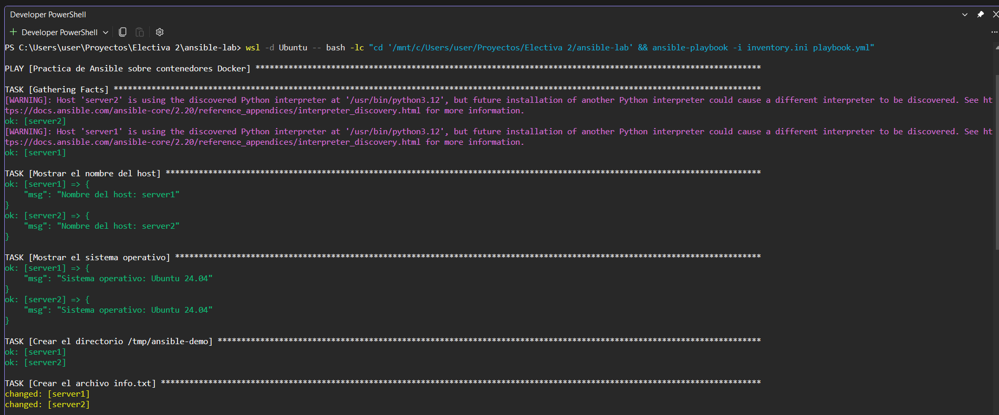
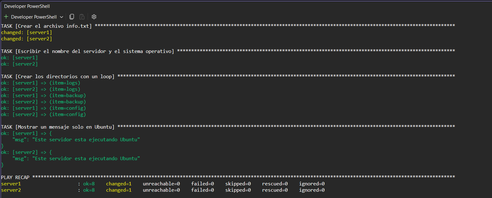

# Ansible Lab

Practica de Ansible usando contenedores Docker como servidores gestionados.

## Objetivo

Crear un laboratorio con dos contenedores Ubuntu (server1 y server2) y administrarlos con Ansible usando la conexion `docker`, sin necesidad de SSH. El playbook debe:

- Mostrar el nombre del host.
- Mostrar el sistema operativo.
- Crear el directorio `/tmp/ansible-demo`.
- Crear el archivo `info.txt` y escribir en el el nombre del servidor y el sistema operativo.
- Crear con un loop los directorios `logs`, `backup` y `config`.
- Mostrar un mensaje unicamente cuando el sistema operativo sea Ubuntu.

## Estructura del proyecto

```
ansible-lab/
├── docker-compose.yml
├── inventory.ini
├── playbook.yml
└── README.md
```

## Requisitos

- Docker y Docker Compose.
- Ansible (con la coleccion `community.docker`, incluida en el paquete `ansible`).

## 1. Iniciar los contenedores

```bash
docker compose up -d
```

Verificar que ambos estan ejecutandose:

```bash
docker ps
```

## 2. Instalar Python en cada contenedor

Ansible necesita Python en el host administrado, y la imagen `ubuntu:24.04` no lo trae.

```bash
docker exec -it server1 bash
apt update
apt install -y python3
exit

docker exec -it server2 bash
apt update
apt install -y python3
exit
```

> Nota: si `apt` falla con `Temporary failure resolving 'archive.ubuntu.com'`, forzar IPv4:
> `apt-get -o Acquire::ForceIPv4=true update` y `apt-get -o Acquire::ForceIPv4=true install -y python3`.

## 3. Comprobar la conexion

```bash
ansible docker -i inventory.ini -m ping
```

Resultado esperado: `SUCCESS` con `"ping": "pong"` para `server1` y `server2`.

## 4. Ejecutar el playbook

```bash
ansible-playbook -i inventory.ini playbook.yml
```

Resultado esperado (resumen final):

```
PLAY RECAP *********************************************************************
server1                    : ok=8    changed=4    unreachable=0    failed=0    skipped=0    rescued=0    ignored=0
server2                    : ok=8    changed=4    unreachable=0    failed=0    skipped=0    rescued=0    ignored=0
```

## 5. Verificar el resultado

```bash
docker exec server1 ls -R /tmp/ansible-demo
docker exec server1 cat /tmp/ansible-demo/info.txt
```

Contenido de `info.txt`:

```
Servidor: server1
Sistema operativo: Ubuntu 24.04
```

## Ejecucion en Windows (WSL)

Ansible no tiene soporte oficial como controlador en Windows, por eso los comandos de Ansible se ejecutan desde la distro WSL Ubuntu, con la integracion de Docker Desktop activada (Settings > Resources > WSL Integration > Ubuntu).

Los comandos de Docker se ejecutan en PowerShell y los de Ansible desde WSL:

```powershell
docker compose up -d
```

```powershell
wsl -d Ubuntu -- bash -lc "cd '/mnt/c/Users/user/Proyectos/Electiva 2/ansible-lab' && ansible docker -i inventory.ini -m ping"
```

```powershell
wsl -d Ubuntu -- bash -lc "cd '/mnt/c/Users/user/Proyectos/Electiva 2/ansible-lab' && ansible-playbook -i inventory.ini playbook.yml"
```

## Capturas de la ejecucion

Ejecucion exitosa del playbook (parte 1: tareas):



Ejecucion exitosa del playbook (parte 2: mensaje de Ubuntu y PLAY RECAP):


